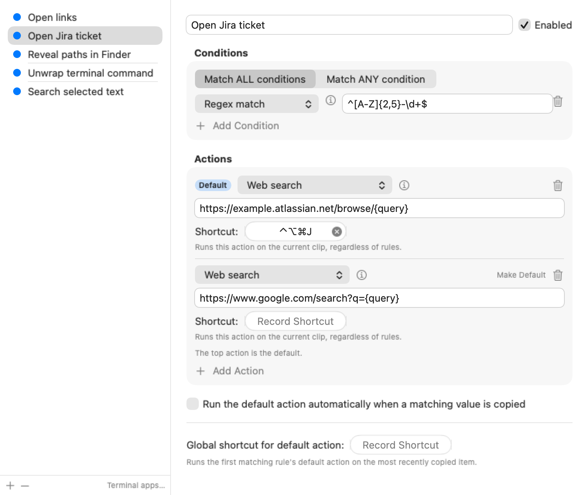
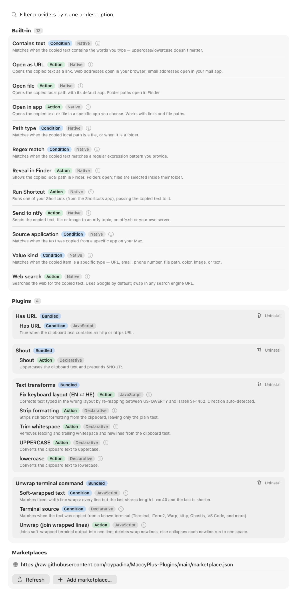

<p align="center">
  
</p>

<h1 align="center">MaccyPlus</h1>

<p align="center"><b>The Maccy clipboard manager, plus automation.</b><br/>
Rules that match what you copy, actions that do something with it, per-action hotkeys, plugins, and a CLI for AI agents.</p>

<p align="center">
  
  
  <a href="https://github.com/roypadina/maccyplus/releases/latest"></a>
  
  <a href="./LICENSE"></a>
  <a href="https://apps.roypadina.synology.me/apps/maccyplus/"></a>
  <a href="https://ko-fi.com/roypadina"></a>
</p>

```sh
brew install --cask roypadina/tap/maccyplus
```

**MaccyPlus** is a fork of [Maccy](https://maccy.app), the fast, keyboard-first, private clipboard manager. It keeps everything Maccy does and adds an automation layer on top. Copy a Jira key, a URL, a file path or a wrapped terminal command and MaccyPlus can act on it with one keystroke, or on its own.



## What MaccyPlus adds over Maccy

| | Maccy | MaccyPlus |
|---|:---:|:---:|
| Searchable clipboard history, keyboard-first, private | yes | yes |
| **Rules**: match a copy by kind, regex, text, source app, file or folder | | yes |
| **Actions**: open in an app, web search, reveal in Finder, transform text, run a Shortcut, send to ntfy | | yes |
| **Per-action global shortcuts**, and auto-run on copy | | yes |
| **Plugins**: declarative or JavaScript, from a marketplace or a drop-in folder | | yes |
| **Agent clipboard API**: `MaccyPlus history ...` for scripts and AI agents | | yes |

* **Rules (conditions)**: match what you copied: URL, email, Jira key, regex, file or folder path, source app, a soft-wrapped terminal command, and more.
* **Actions**: act on it: open in an app, web search with any URL template, reveal in Finder, transform text (trim, UPPERCASE, strip formatting, unwrap), run a macOS Shortcut, or send it to your phone with ntfy.
* **Per-action shortcuts**: bind any action to its own global hotkey, or run it automatically the moment you copy.
* **Plugins**: add conditions and actions without rebuilding the app. See [Plugins](#plugins).
* **Agent clipboard API**: scripts and AI agents can read your history and leave values in it. See [Let AI agents leave values in your history](#let-ai-agents-leave-values-in-your-history).



MaccyPlus tracks upstream Maccy and is currently synced with **Maccy 2.7.1 plus upstream fixes up to October 2026**. Full documentation is in the [Wiki](https://github.com/roypadina/maccyplus/wiki): actions and rules, plugins, the command line, permissions, troubleshooting.

## Requirements

macOS 14 Sonoma or later · Apple Silicon and Intel (universal binary)

## Install

MaccyPlus is distributed through a [Homebrew](https://brew.sh/) tap:

```sh
brew install --cask roypadina/tap/maccyplus
```

...or download the `.zip` from the [latest release](https://github.com/roypadina/maccyplus/releases/latest).

MaccyPlus is self-signed (not notarized), so macOS blocks it on first launch. Open it once, then go to **System Settings → Privacy & Security** and click **Open Anyway** (macOS 15 and later; right-click → Open no longer works there). Or clear the quarantine flag instead:

```sh
xattr -dr com.apple.quarantine "/Applications/MaccyPlus.app"
```

It's a menu-bar app (no Dock icon). On first launch a **Welcome** window explains the menu bar icon and offers an **Open at Login** switch and an **Allow Accessibility…** button. Accessibility (System Settings → Privacy & Security → Accessibility) is only needed to paste into the app you're using; copying works without it, and MaccyPlus no longer asks for it at every launch. Open the window again from About → Welcome Guide….

> [!WARNING]
> **Beware of fake websites impersonating Maccy.** Malicious sites (such as `maccyapp.net` and `maccyapp.com`) distribute malware disguised as Maccy. [**maccy.app**](https://maccy.app) is the **only** official website for Maccy. MaccyPlus is only distributed from this repo and the `roypadina/tap` Homebrew tap.

<!-- vim-markdown-toc GFM -->

* [What MaccyPlus adds over Maccy](#what-maccyplus-adds-over-maccy)
* [Requirements](#requirements)
* [Install](#install)
* [Build from source](#build-from-source)
* [Using the popup](#using-the-popup)
* [Actions](#actions)
* [Plugins](#plugins)
* [Advanced](#advanced)
* [FAQ](#faq)
* [Translations](#translations)
* [Support](#support)
* [License](#license)

<!-- vim-markdown-toc -->

## Build from source

Needs Xcode (macOS 14+ deployment target). The default build is signed ad hoc ("Sign to Run Locally"), so no signing identity or Apple Developer account is required:

```sh
git clone https://github.com/roypadina/maccyplus.git
cd maccyplus
Scripts/build-release.sh        # universal build + build/MaccyPlus.zip
open build/Build/Products/Release/MaccyPlus.app
```

Ad-hoc builds get a new code identity each time, so macOS asks again for Accessibility after a rebuild. To keep the grant, create a self-signed code-signing certificate and build with `MACCYPLUS_SIGN_IDENTITY="<certificate name>" Scripts/build-release.sh`.

## Using the popup

1. <kbd>OPTION (⌥)</kbd> + <kbd>COMMAND (⌘)</kbd> + <kbd>C</kbd> to popup MaccyPlus or click on its icon in the menu bar.
2. Type what you want to find.
3. To select the history item you wish to copy, press <kbd>ENTER</kbd>, or click the item, or use <kbd>COMMAND (⌘)</kbd> + `n` shortcut.
4. To choose the history item and paste, press <kbd>OPTION (⌥)</kbd> + <kbd>ENTER</kbd>, or <kbd>OPTION (⌥)</kbd> + <kbd>CLICK</kbd> the item, or use <kbd>OPTION (⌥)</kbd> + `n` shortcut.
5. To choose the history item and paste without formatting, press <kbd>OPTION (⌥)</kbd> + <kbd>SHIFT (⇧)</kbd> + <kbd>ENTER</kbd>, or <kbd>OPTION (⌥)</kbd> + <kbd>SHIFT (⇧)</kbd> + <kbd>CLICK</kbd> the item, or use <kbd>OPTION (⌥)</kbd> + <kbd>SHIFT (⇧)</kbd> + `n` shortcut.
6. To delete the history item, press <kbd>OPTION (⌥)</kbd> + <kbd>DELETE (⌫)</kbd>.
7. To see the full text of the history item, wait a couple of seconds for tooltip.
8. To pin the history item so that it remains on top of the list, press <kbd>OPTION (⌥)</kbd> + <kbd>P</kbd>. The item will be moved to the top with a random but permanent keyboard shortcut. To unpin it, press <kbd>OPTION (⌥)</kbd> + <kbd>P</kbd> again.
9. To clear all unpinned items, select _Clear_ in the menu, or press <kbd>OPTION (⌥)</kbd> + <kbd>COMMAND (⌘)</kbd> + <kbd>DELETE (⌫)</kbd>. To clear all items including pinned, select _Clear_ in the menu with  <kbd>OPTION (⌥)</kbd> pressed, or press <kbd>SHIFT (⇧)</kbd> + <kbd>OPTION (⌥)</kbd> + <kbd>COMMAND (⌘)</kbd> + <kbd>DELETE (⌫)</kbd>.
10. To disable MaccyPlus and ignore new copies, click on the menu icon with <kbd>OPTION (⌥)</kbd> pressed.
11. To ignore only the next copy, click on the menu icon with <kbd>OPTION (⌥)</kbd> + <kbd>SHIFT (⇧)</kbd> pressed.
12. To run one of the item's [actions](#actions) from the keyboard, press <kbd>OPTION (⌥)</kbd> + <kbd>COMMAND (⌘)</kbd> + `n` (1–9) for the nth action in the Actions list (it used to be <kbd>CONTROL (⌃)</kbd> + `n`, which macOS reserves for switching Desktops). VoiceOver lists the same actions on each row.
13. To customize the behavior, check "Preferences…" window, or press <kbd>COMMAND (⌘)</kbd> + <kbd>,</kbd>.

## Actions

Actions let MaccyPlus *do something* with a copied value instead of just storing it. An
**action rule** has **conditions** (when it applies) and one or more ordered **actions**
(what it does). A rule can run from the popup's right-click menu, from a global shortcut,
from a per-action shortcut, or automatically the moment a matching value is copied.
Rules are edited under Preferences → Actions.

**Conditions** — kind (URL, email, phone, file path, color hex, image, text), **path type
(file or folder)**, regex,
contains-text, source app, **soft-wrapped** (the value looks like a wrapped terminal
command), and **from a terminal** (the copy came from a configured terminal app). A rule
matches when *all* or *any* of its conditions hold.

**Actions** — open as URL, open in a specific app, web search, **reveal in Finder**,
**open a local file**,
**transform text** (trim, UPPERCASE, lowercase, strip formatting, **unwrap**), run a
macOS Shortcut, and **send to ntfy**.

### Unwrap soft-wrapped terminal commands

When a coding agent or CLI prints a long command in the terminal, the terminal wraps it
across several visual lines. Copying it brings along the line breaks, so pasting it
elsewhere fails. The **unwrap** transform strips those wrap breaks and leaves a single,
ready-to-paste command on the clipboard.

The built-in **"Unwrap terminal command"** rule does this automatically: when a copy comes
**from a terminal app** *and* shows a fixed-width wrap signature, the wrap breaks are
removed (the original command is reconstructed exactly — no merged tokens, no spurious
spaces). Genuine multi-line scripts are left untouched. You can also trigger unwrap
manually by giving the action a [per-action shortcut](#per-action-shortcuts).

### Reveal local paths in Finder

Copy a local path — `~/Projects/app/`, `/var/log/system.log`, a `file://` URL, or a file
from Finder — and the **Reveal in Finder** action shows it: a folder path opens that folder;
a file path opens the containing folder with the file selected. Pair it with the **file path**
kind condition. Tip: put that rule *above* any "kind = text" rule so the global default-action
shortcut prefers it (rules are matched top to bottom):

```sh
"$BIN" rules add --json '{"name":"Reveal local path in Finder",
  "conditions":[{"id":"'"$(uuidgen)"'","provider":"builtin.kind","params":{"kind":"filePath"}}],
  "actions":[{"provider":"builtin.revealInFinder","params":{}}]}'
"$BIN" rules move <rule-id> 0
```

Opening a folder asks Finder via Apple Events, so macOS shows a one-time
"MaccyPlus wants to control Finder" prompt.

### Open local files

The **Open file** action opens the copied path with whatever app macOS normally uses for it;
a folder path opens that folder in Finder. It takes the same path forms as *Reveal in Finder*.
Give it a per-action shortcut so opening and revealing sit on different keys:

```sh
"$BIN" rules add --json '{"name":"Open local file",
  "conditions":[{"id":"'"$(uuidgen)"'","provider":"builtin.kind","params":{"kind":"filePath"}}],
  "actions":[{"provider":"builtin.openFile","params":{},"shortcut":"ctrl+opt+cmd+o"}]}'
```

MaccyPlus is sandboxed and holds a **read-only** exception for the filesystem, so a file it
opens this way may be read-only in the receiving app if that app has no access of its own.

### Tell files and folders apart

The **Path type** condition (`builtin.pathType`, `file` or `folder`) checks the copied path
on disk, so one rule can handle files and another handle folders — for example open files in
their app while folders open in Finder:

```sh
"$BIN" rules add --json '{"name":"Open local file",
  "conditions":[{"id":"'"$(uuidgen)"'","provider":"builtin.kind","params":{"kind":"filePath"}},
                {"id":"'"$(uuidgen)"'","provider":"builtin.pathType","params":{"type":"file"}}],
  "actions":[{"provider":"builtin.openFile","params":{}}]}'
```

A path that does not exist matches neither type.

### Send to your phone with ntfy

The **Send to ntfy** action publishes the clip to an [ntfy](https://ntfy.sh) topic, so it shows
up on your phone or any other ntfy client. Fields:

- **Server**: leave empty for ntfy.sh, or enter your own server (`https://` is added if missing).
- **Topic** (required), an optional **Title**, and optional **Tags**, comma-separated. A tag
  that is an emoji name (`warning`, `tada`, `computer`) shows as that emoji.
- **Username** and **Password** for a protected topic, or leave the username empty and put an
  access token (`tk_…`) in the password field. The password is stored in your Keychain; the rule
  keeps only a reference to it.

Text is sent as the message. Copied files arrive as attachments, one message per file, and a
copied image arrives as a PNG. ntfy.sh accepts attachments up to 15 MB; a self-hosted server
needs attachments enabled. A notification tells you whether it was sent. Give the action a
per-action shortcut to send whatever you copied last, whatever its kind.

### Per-action shortcuts

Any single action can carry its own keyboard shortcut (recorded in the rule editor). That
shortcut runs **only that action** on the current clipboard, unconditionally — independent
of rule matching and of the global default-action shortcut. Specs look like `cmd+shift+u`.

### Terminal apps

The **from a terminal** condition matches copies whose source app is in a configurable
list (Terminal.app, iTerm2, Warp, kitty, Alacritty, WezTerm, Ghostty, VS Code by default).
Edit the list under Preferences → Actions → "Terminal apps…", or from the command line.

### Configure actions from the command line

MaccyPlus ships a headless CLI so rules, actions, the terminal-app list, and per-action
shortcuts can be managed without the GUI — useful for scripting and for AI coding agents.
The running app picks up changes immediately.

```sh
APP=$(mdfind "kMDItemCFBundleIdentifier == 'com.royp.MaccyPlus'" | head -1)
BIN="$APP/Contents/MacOS/MaccyPlus"

"$BIN" rules describe          # live JSON schema: condition/action/transform catalog
"$BIN" rules list              # all rules as JSON
"$BIN" rules add  --json '…'   # create a rule (also: get/update/remove/move/enable/disable/import)
"$BIN" terminals list          # the terminal-app list (also: add/remove/reset)
"$BIN" plugins list            # packages, disabled ids, local folders, marketplace URLs
"$BIN" plugins enable  <id>    # toggle a package on  (also: disable)
"$BIN" folders list            # registered local plugin folders
"$BIN" folders add    <path>   # register a folder — use this after building a plugin
"$BIN" folders remove <path>   # unregister a folder
```

All commands take and emit JSON and validate input before writing. For the full schema,
command reference, and recipes — including how an agent should drive it — see the bundled
skill at [`.claude/skills/maccyplus/SKILL.md`](.claude/skills/maccyplus/SKILL.md).

### Let AI agents leave values in your history

Agents can add values to your clipboard history with a **label** (e.g. the session that
produced it) and a **note** (what it is, where to run it), and read, pin, move, copy,
relabel or delete items. Labels show as a chip on the row, notes on hover and in the
preview, and the popup search matches both. Requires the app to be running.

```sh
printf 'SELECT 1;' | "$BIN" history add --label "orders-debug" --note "DataGrip → dev"
"$BIN" history list --label orders-debug   # also: get/update/pin/unpin/top/copy/delete
```

`add` puts the value at the top of history without touching the live clipboard (`--copy`
does both). Full reference: [Agent clipboard API](https://github.com/roypadina/maccyplus/wiki/Agent-clipboard-API).

For Claude Code, install the
[`maccyplus-clipboard`](https://github.com/roypadina/padina-claude-code-plugins/tree/main/maccyplus-clipboard)
plugin. It teaches Claude to label each value with its session name and a note on where to run it:

```
/plugin marketplace add roypadina/padina-claude-code-plugins
/plugin install maccyplus-clipboard@padina
```

## Plugins

Conditions and actions aren't hard-coded — most ship as **plugins**, and you can add your
own. A plugin is a folder with a `plugin.json` manifest declaring one or more providers
(conditions and/or actions), implemented two ways:

* **Declarative** — pure JSON: a transform pipeline (regex-replace, case, trim,
  prepend/append) or a predicate tree (regex / contains / kind / source-app, combined with
  all / any / not). No code.
* **JavaScript** — a small sandboxed script (no network, no filesystem, no timers; ~250 ms
  watchdog) that returns the transformed string or a boolean.

**GUI path:** Manage plugins under **Settings → Plugins**: browse a marketplace,
**install** / **uninstall** packages, read each provider's description, enable/disable
individual packages, and add **local folders** during development. The first-party plugins
(terminal unwrap, text transforms, …) ship bundled and can be disabled like any other.
Marketplace install and uninstall are GUI-only — they involve async network I/O that the
CLI does not expose.

**Agent / CLI path:** Build a plugin as a folder with a `plugin.json` manifest (and
optional `.js` entry files), then register it with `"$BIN" folders add <path>`. The
running app reloads immediately. Use `"$BIN" plugins enable/disable <id>` to toggle
packages. See [`.claude/skills/maccyplus/SKILL.md`](.claude/skills/maccyplus/SKILL.md)
for the full plugin schema and a step-by-step agent recipe.

The official marketplace lives at
**[roypadina/MaccyPlus-Plugins](https://github.com/roypadina/MaccyPlus-Plugins)** — see
its `docs/` for how to author and publish your own.

## Advanced

### Ignore Copied Items

You can tell MaccyPlus to ignore all copied items:

```sh
defaults write com.royp.MaccyPlus ignoreEvents true # default is false
```

This is useful if you have some workflow for copying sensitive data. You can set `ignoreEvents` to true, copy the data and set `ignoreEvents` back to false.

You can also click the menu icon with <kbd>OPTION (⌥)</kbd> pressed. To ignore only the next copy, click with <kbd>OPTION (⌥)</kbd> + <kbd>SHIFT (⇧)</kbd> pressed.

### Ignore Custom Copy Types

By default MaccyPlus will ignore certain copy types that are considered to be confidential
or temporary. The default list always include the following types:

* `org.nspasteboard.TransientType`
* `org.nspasteboard.ConcealedType`
* `org.nspasteboard.AutoGeneratedType`

Also, default configuration includes the following types but they can be removed
or overwritten:

* `com.agilebits.onepassword`
* `com.typeit4me.clipping`
* `de.petermaurer.TransientPasteboardType`
* `Pasteboard generator type`
* `net.antelle.keeweb`

You can add additional custom types using settings.
To find what custom types are used by an application, you can use
free application [Pasteboard-Viewer](https://github.com/sindresorhus/Pasteboard-Viewer).
Simply download the application, open it, copy something from the application you
want to ignore and look for any custom types in the left sidebar. [Here is an example
of using this approach to ignore Adobe InDesign](https://github.com/p0deje/Maccy/issues/125).

### Speed up Clipboard Check Interval

By default, MaccyPlus checks clipboard every 500 ms, which should be enough for most users. If you want
to speed it up, you can change it with `defaults`:

```sh
defaults write com.royp.MaccyPlus clipboardCheckInterval 0.1 # 100 ms
```

## FAQ

### Why doesn't it paste when I select an item in history?

1. Make sure you have "Paste automatically" enabled in Preferences.
2. Make sure "MaccyPlus" is added to System Settings -> Privacy & Security -> Accessibility.

### When assigning a hotkey to open Maccy, it says that this hotkey is already used in some system setting.

1. Open System settings -> Keyboard -> Keyboard Shortcuts.
2. Find where that hotkey is used. For example, "Convert text to simplified Chinese" is under Services -> Text.
3. Disable that hotkey or remove assigned combination ([screenshot](https://github.com/p0deje/Maccy/assets/576152/446719e6-c3e5-4eb0-95fb-5a811066487f)).
4. Restart MaccyPlus.
5. Assign hotkey in MaccyPlus settings.

### How to restore hidden footer?

1. Open MaccyPlus window.
2. Press <kbd>COMMAND (⌘)</kbd> + <kbd>,</kbd> to open preferences.
3. Enable footer in Appearance section.

If for some reason it doesn't work, run the following command in Terminal.app:

```sh
defaults write com.royp.MaccyPlus showFooter 1
```

### How to ignore copies from [Universal Clipboard](https://support.apple.com/en-us/102430)?

1. Open Preferences -> Ignore -> Pasteboard Types.
2. Add `com.apple.is-remote-clipboard`.

### My keyboard shortcut stopped working in password fields. How do I fix this?

If your shortcut produces a character (like `Option+C` → "ç"), macOS security may block it in password fields. Use [Karabiner-Elements](https://karabiner-elements.pqrs.org/) to remap your shortcut to a different combination like `Cmd+Shift+C`. [See detailed solution](docs/keyboard-shortcut-password-fields.md).

## Translations

The translations are hosted in [Weblate](https://hosted.weblate.org/engage/maccy/).
You can use it to suggest changes in translations and localize the application to a new language.

[](https://hosted.weblate.org/engage/maccy/)

## Feature requests and contributions

Have an idea for MaccyPlus? [Request a feature](https://github.com/roypadina/maccyplus/issues/new?template=feature_request.yml) and say what you're trying to do; that matters more than the exact feature. Found a bug? [Report it](https://github.com/roypadina/maccyplus/issues/new?template=bug_report.yml).

Code is welcome too: small, focused pull requests, and an issue first for anything bigger. See [CONTRIBUTING.md](CONTRIBUTING.md).

Tipped on [Ko-fi](https://ko-fi.com/roypadina)? Add your Ko-fi name to the request and it goes to the front of my queue. It's a thank-you, not a purchase: no promise on what ships or when.

## More Mac apps by Roy

Free, open-source Mac menu-bar apps and terminal tools, all on one site: **[apps.roypadina.synology.me](https://apps.roypadina.synology.me/)**.

- [NtfyBar](https://apps.roypadina.synology.me/apps/ntfybar/) — ntfy notifications on your Mac: popups that stay, rules, commands, plugins.
- [Window Organizer](https://apps.roypadina.synology.me/apps/window-organizer/) — Clear the desk in one keystroke.
- [SmartHiddenBar](https://apps.roypadina.synology.me/apps/smarthiddenbar/) — Hide the menu bar clutter. Reach it in one click.
- [VaultBar](https://apps.roypadina.synology.me/apps/vaultbar/) — Your encrypted vaults, one click from the menu bar.

## Support

If MaccyPlus saves you time with your clipboard, you can support its development — it's optional and always appreciated.

[](https://ko-fi.com/roypadina)

A ⭐ on the repo helps just as much.

## License

[MIT](./LICENSE)
